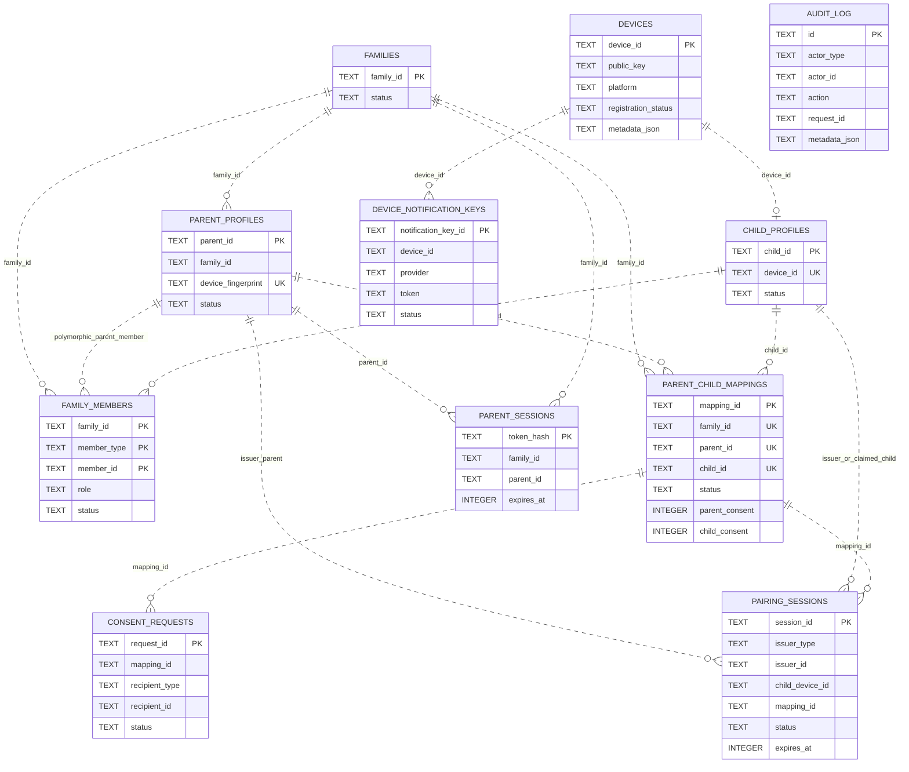
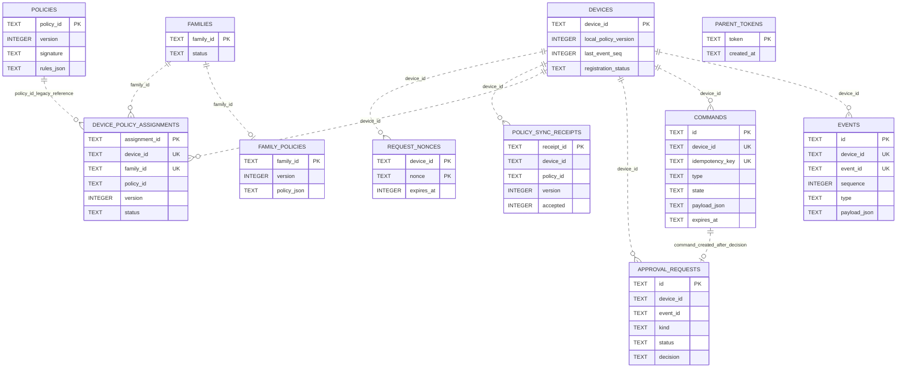
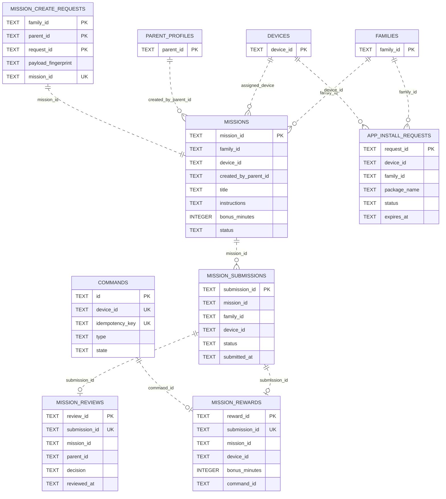
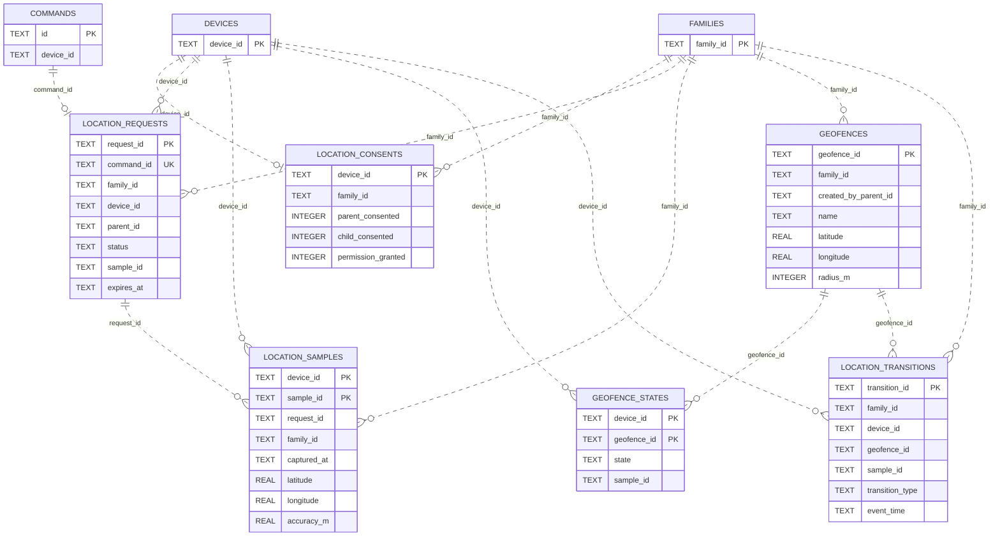
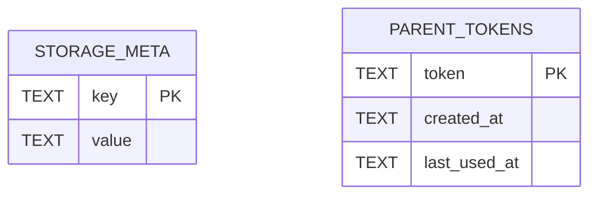

# CPSM 현재 ERD

기준: `cpsm-server/src/store.js`의 `configureDatabase()`를 격리된 임시 디렉터리에서 실행해 확인한 SQLite schema. 현재 schema는 **38개 테이블**이다. 이 ERD는 key 및 관계 컬럼 중심도이며 전체 컬럼/제약은 [`../SCHEMA.md`](../SCHEMA.md)와 `src/store.js`를 따른다.

## 관계 표기

- `--` : 실제 SQLite `FOREIGN KEY` 제약이 있음.
- `..` : 서버 코드에서 확인되는 논리적 참조/인가 관계이며, SQLite FK 제약은 없음.
- polymorphic references (`family_members.member_type/member_id`, `audit_log.actor_type/actor_id`)는 컬럼 조합으로 해석한다.
- 기존 schema는 telemetry 4개 FK 외에 대부분 application-level integrity를 사용한다. 점선 관계를 DB-enforced 관계로 해석하면 안 된다.

## Identity, Family, mapping, consent



`family_members` is the active membership/role surface. `parent_child_mappings` separately records the relationship and both compatibility consent flags. QR `pairing_sessions` point to a pending mapping until explicit confirmation. Parent session bearer values are stored as hashes. `device_notification_keys` is unique by `(device_id,provider,token)`.

## Device activity, policy and commands



`commands` has unique `(device_id, idempotency_key)`; `events` has unique `(device_id, event_id)`; `device_policy_assignments` has unique `(device_id, family_id)`. These are uniqueness constraints, not foreign keys. Screen-time approval/request objects and commands have application-level links. `family_policies.policy_json.rules[]` may contain an optional device target; the server validates confirmed family membership on write and filters signed policy rules per target device. This scope is encoded in JSON and adds no table or relational constraint.

## Missions and app-install requests



Mission create idempotency is scoped by `(family_id, parent_id, request_id)` and stores only a SHA-256 fingerprint of normalized create fields; `mission_id` is unique. One review and one reward maximum per submission are enforced by unique indexes. The reward command is a separate queue record and only positive-minute rewards reference it. App-install requests have a partial unique index for one pending `(device_id,package_name)`; approval records permission only and creates no install command.

## Location and geofence records



Location values remain in location-specific tables. The first valid sample establishes geofence baseline; derived transitions are not interpolated routes. Location cooldown is computed from per-device terminal `location_requests.updated_at` and a server configuration value; it adds no table or FK. All relations in this diagram are logical references; SQLite has no declared FK constraints for the location tables.

## Release telemetry

```mermaid
erDiagram
  APP_VERSIONS {
    TEXT platform PK
    TEXT product PK
    INTEGER version_code PK
    TEXT sha256
  }
  APP_VERSION_CHANGES {
    TEXT change_id PK
    TEXT platform FK
    TEXT product FK
    INTEGER version_code FK
    TEXT issue_id
  }
  DEVICE_ERRORS {
    TEXT error_id PK
    TEXT fingerprint UK
    TEXT product
    TEXT status
    INTEGER is_fixed
  }
  DEVICE_ERROR_OCCURRENCES {
    TEXT occurrence_id PK
    TEXT error_id FK
    TEXT device_id UK
    TEXT client_error_id UK
  }
  ERROR_APP_VERSION_LINKS {
    TEXT error_id FK PK
    TEXT platform FK PK
    TEXT product FK PK
    INTEGER version_code FK PK
    TEXT relation PK
  }
  DEVICES {
    TEXT device_id PK
  }

  APP_VERSIONS ||--o{ APP_VERSION_CHANGES : fk_release_version
  APP_VERSIONS ||--o{ ERROR_APP_VERSION_LINKS : fk_release_version
  DEVICE_ERRORS ||--o{ DEVICE_ERROR_OCCURRENCES : fk_error
  DEVICE_ERRORS ||--o{ ERROR_APP_VERSION_LINKS : fk_error
  DEVICES ||..o{ DEVICE_ERROR_OCCURRENCES : device_id
```

These are the only declared FK families in the current schema: release changes and error/version links point to `app_versions`; error occurrences and error/version links point to `device_errors`. `device_error_occurrences` also has unique `(device_id, client_error_id)`; `device_errors.fingerprint` is unique.

## Remaining support tables



`storage_meta(key,value)` tracks schema initialization/migration; `parent_tokens(token,created_at,last_used_at)` is legacy notification compatibility. Both are present in the 38-table inventory but do not add domain relationships beyond those shown above.
